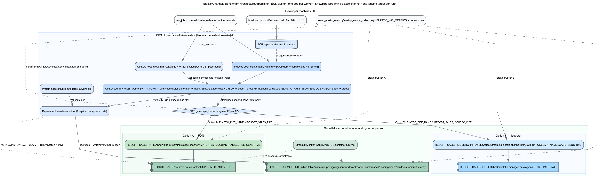

# Architecture

**Diagram source:** [`architecture.dot`](./architecture.dot) → [`architecture.png`](./architecture.png)

Regenerate the PNG after any design change:

```bash
./scripts/render_architecture.sh
```



## Scenario

Demonstrate that Snowpipe Streaming **elastic channels** (`client.get_elastic_channel()`, shared
channel pooling under one client/pipe) sustain high-throughput ingest while measuring end-to-end
commit latency.

The workload is a synthetic ski-resort **point-of-sale** record covering season tickets, day
tickets, food & drink, and branded merchandise across a synthetic 42-resort ski portfolio:
`TXID`, `RESORT`, `CATEGORY`, `ITEM`, `CUSTOMER_TYPE`, `PAYMENT_METHOD`, `QUANTITY`, `UNIT_PRICE`,
`AMOUNT`, `SALE_TIME`, `RUN_ID`, `WORKER_ID`. Each resort has a distinct sales profile (relative
volume, category mix, price tier, pass-holder share) so aggregate reporting by resort is
distinctive rather than uniform-random. Rows are generated in-process (no I/O, no RNG in the hot
loop — see [`src/elastic_channels/resort_sales.py`](../src/elastic_channels/resort_sales.py)) so
client-side generation is never the bottleneck at target throughput.

Compute runs on a persistent **EKS cluster**, one worker per pod, in fixed-throughput mode: every
pod ingests at a static target rate (bytes/sec) for a fixed duration. To explore a different
throughput level, submit a new `run_job.sh` with a different `--target-bps`.

## Approach

The `snowflake-ingest-sdk` (`snowpipe-streaming` Python package) is used directly, so the
measurement reflects raw SDK/channel throughput and commit latency rather than query workload.

Each worker runs in its own pod (`src/elastic_channels/k8s_worker.py`), opening one elastic
channel against the pipe for the landing target selected for that run, and appending batches sized
to hit its share of the aggregate target bytes/sec. Each pod periodically reports its own
throughput as a JSON line to stdout.

A run uses one of two landing targets (`ELASTIC_PIPE_NAME` selects the pipe):

- **Option A — FDN.** Native table `RESORT_SALES` (the current table) with `ROW_TIMESTAMP = TRUE`,
  via `RESORT_SALES_PIPE`. Row timestamp enables `METADATA$ROW_LAST_COMMIT_TIME` for commit-latency
  measurement.
- **Option B — Iceberg.** Snowflake-managed Iceberg table `RESORT_SALES_ICEBERG`, via
  `RESORT_SALES_ICEBERG_PIPE`. Iceberg does not support `ROW_TIMESTAMP`.

**JSON fast-path** (`ELASTIC_FAST_JSON_ENCODE`, on by default): each worker pre-encodes its NDJSON
payload itself — in Rust via the optional [`native/`](../native/) extension when installed
(row generation *and* encoding both happen in Rust, skipping per-row Python dict construction
entirely), otherwise in Python via msgspec — and appends it straight through the elastic channel,
skipping a redundant re-encode step either way. Falls back automatically to the msgspec path when
the native extension isn't installed; both paths produce byte-identical NDJSON (see
`tests/unit/test_native_encoder.py`). The Rust tables are generated from `resort_sales.py`'s own
resolved weighted structures — see [`native/generate_tables.py`](../native/generate_tables.py) for
the regeneration workflow after changing resorts, categories, items, or weights.

A single long-lived **monitor** (`src/elastic_channels/k8s_monitor.py`, one `Deployment` replica on
the always-on `system` node group) tails every worker pod's logs, aggregates them into fixed
windows (`ELASTIC_MONITOR_FLUSH_SECONDS`, default 30s), periodically measures end-to-end commit
latency (`SALE_TIME` → `METADATA$ROW_LAST_COMMIT_TIME`), and writes one row per window directly to
the `ELASTIC_K8S_METRICS` Snowflake table. Because the monitor is a single persistent Deployment,
it discovers and tracks whichever worker pods currently exist, so multiple runs can be launched
back-to-back without redeploying it.

The ingest pipe uses `MATCH_BY_COLUMN_NAME = CASE_SENSITIVE`, mapping payload keys straight to
typed columns rather than landing the whole row into one `VARIANT` column — see
[`sql/setup/setup_elastic_ramp.sql`](../sql/setup/setup_elastic_ramp.sql) for the full DDL.

## Snowflake objects

| Object | Name / pattern | Purpose |
|--------|----------------|---------|
| Database / Schema | `SC_DB.SC_SCHEMA` (configurable via `SNOWFLAKE_DATABASE` / `SNOWFLAKE_SCHEMA`) | |
| Table (Option A — FDN) | `RESORT_SALES` (`ROW_TIMESTAMP = TRUE`) | Current native ingest target; `ROW_TIMESTAMP` enables `METADATA$ROW_LAST_COMMIT_TIME` for latency analysis |
| Pipe (Option A — FDN) | `RESORT_SALES_PIPE` (`COPY INTO ... FROM TABLE(DATA_SOURCE(TYPE => 'STREAMING')) MATCH_BY_COLUMN_NAME = CASE_SENSITIVE`) | Snowpipe Streaming pipe for the current FDN table. Default `ELASTIC_PIPE_NAME` |
| Table (Option B — Iceberg) | `RESORT_SALES_ICEBERG` (Snowflake-managed catalog; no `ROW_TIMESTAMP`) | Alternate ingest target (`sql/setup/setup_elastic_iceberg.sql`) |
| Pipe (Option B — Iceberg) | `RESORT_SALES_ICEBERG_PIPE` (same streaming `COPY INTO` shape) | Snowpipe Streaming pipe for the Iceberg table. Set `ELASTIC_PIPE_NAME=RESORT_SALES_ICEBERG_PIPE` |
| Hybrid table | `ELASTIC_K8S_METRICS` | Live aggregated performance data, written continuously during a run by `k8s_monitor.py` — a hybrid table (`PRIMARY KEY (RUN_ID, WINDOW_START)`), matched to the monitor's frequent single-row inserts and readers' point/range lookups by `RUN_ID` |
| Network rule | `{database}.{schema}.ELASTIC_RAMP_INGRESS` allowlists EKS NAT IPs and the operator host (`scripts/setup_elastic_ramp.py`). Account attach is opt-in. | |
| Warehouse | Single default warehouse (e.g. `XSMALL`/`LARGE_WH`) | Setup DDL, dashboard, and the monitor's commit-latency query |
| Streamlit app | `ELASTIC_RAMP_MONITOR` (SPCS container runtime) | Live throughput/latency dashboard (`streamlit/Monitor_App.py`) + a real-time resort-sales page (`streamlit/pages/01_Resort_Sales.py`) |

## EKS test flow

The EKS cluster (`snowflake-elastic-channels`, `us-west-2`) is **persistent** — created once via
`eksctl` and left running between runs. It has two managed node groups: `system` (1× `m7g.large`,
always on, hosts the monitor and cluster add-ons) and `workers` (0–15× `m7g.8xlarge`, scaled to
zero between runs, tainted so only worker pods schedule there). Both node groups use
`privateNetworking: true`, so all pod egress goes through the cluster VPC's NAT gateway(s) — a
small, stable set of IPs to allowlist once.

Each worker pod requests **1 vCPU / 1Gi memory**, sized from measured steady-state usage with the
default fast JSON encode path (well under 1 vCPU at realistic per-worker rates, with headroom for
bursts). An `m7g.8xlarge` (32 vCPU / 128GiB nominal, ~31.85 vCPU / ~120.7GiB allocatable after
system-reserved overhead) schedules **31** worker pods per node (`WORKERS_PER_NODE` in
`infra/eks/lib/eks_env.sh`) — the CPU-bound limit at this sizing, with ample memory headroom to
spare. The `workers` node group's cap (15 nodes) covers the full supported range of **1 to 455
workers** per run.

One-time cluster setup:

1. **create_cluster.sh** — `eksctl create cluster` from `infra/eks/cluster.yaml`; applies the `elastic-ramp` namespace and monitor RBAC
2. **build_and_push.sh** — build the worker/monitor image (arm64, single `Dockerfile` for both entrypoints) and push to ECR, tagged by git SHA + `latest`
3. **create_secret.sh** — create the `snowflake-credentials` Secret from local `.env`
4. **allowlist_eks.sh** — discover the cluster's NAT gateway IP(s) and merge them (plus this host) into `ELASTIC_RAMP_INGRESS` via `scripts/setup_elastic_ramp.py --ingest-ips` / `--orchestrator-ip`. Does not attach a network policy to the account.
5. **deploy_monitor.sh** — deploy the single persistent `elastic-monitor` `Deployment`

Per-run flow (`run_job.sh <run-id> --target-bps <N> --duration-seconds <N> --workers <1-455>`):

1. **scale_workers.sh** — scale the `workers` node group to fit the requested worker count (rounds up to whole nodes)
2. Render and apply the worker `Indexed Job` (`infra/eks/manifests/worker-job.yaml.tmpl`) — one pod per worker, `JOB_COMPLETION_INDEX` as the stable worker id, aggregate target split evenly across pods
3. Each pod runs the ingest loop at its fixed rate for `--duration-seconds`, emitting JSON stats to stdout
4. The already-running monitor tails every pod's logs continuously, aggregates, and writes rows to `ELASTIC_K8S_METRICS` throughout the run — query Snowflake directly, including while the run is still in progress
5. `run_job.sh` waits for the job to complete, then scales the `workers` node group back to zero (unless `--keep-nodes` is passed)

## Observability

| Artifact | Location | Purpose |
|----------|----------|---------|
| Live/aggregated performance | Snowflake `ELASTIC_K8S_METRICS`, filtered by `RUN_ID` | Rows/sec, uncompressed/compressed bytes/sec, compression ratio, batch-ack latency, commit latency — one row per aggregation window, written continuously during the run |
| Raw worker output | `kubectl -n elastic-ramp logs -l run-id=<run-id> --prefix --tail=-1` | Per-pod JSON records (see `k8s_worker.py`) |
| Live dashboard | `streamlit/Monitor_App.py` (deployed to Snowflake) | Throughput and latency, queryable while a run is in progress |
| Live resort-sales page | `streamlit/pages/01_Resort_Sales.py` (same app, second page) | Revenue, mix, geography, and a live transaction feed from `RESORT_SALES`, auto-refreshing |

## Setup order

1. `cp .env.example .env` — fill in Snowflake credentials
2. `python scripts/setup_elastic_ramp.py --ingest-ip <IP>` — create Snowflake objects once per account
3. One-time EKS cluster setup: `./infra/eks/create_cluster.sh && ./infra/eks/build_and_push.sh && ./infra/eks/create_secret.sh && ./infra/eks/allowlist_eks.sh && ./infra/eks/deploy_monitor.sh`
4. `./infra/eks/run_job.sh <run-id> --target-bps <N> --duration-seconds <N> --workers <1-455>` — run the benchmark
